# AgentDesk: Mini AI Agent Platform for Businesses

Built by **Umama Qayum Khan**, BS Computer Science, Iqra University Islamabad.

📄 **[Full project documentation with all screens (PDF)](AgentDesk_Project_Documentation.pdf)** · 🎬 [Demo video](docs/AgentDesk_Demo.mp4) · 🎤 [Interview guide](docs/INTERVIEW_GUIDE.md)

## 🎬 Demo

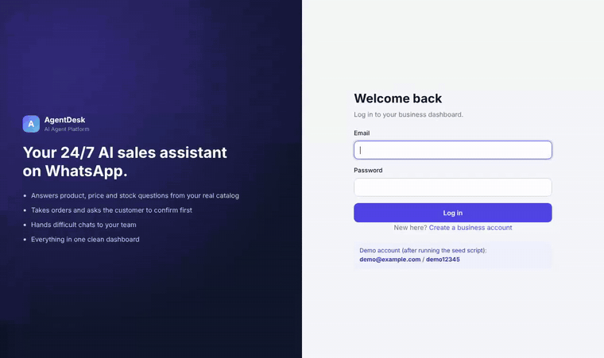

*Customer orders on WhatsApp → order appears on the dashboard → owner tells the AI assistant "mark order 6 as shipped" → customer gets an automatic update. [Full video (MP4)](docs/AgentDesk_Demo.mp4)*

AgentDesk lets a business connect an AI agent to WhatsApp. The agent works on **two sides**:

- **Customer side (WhatsApp):** it answers questions about products, prices and stock from the business's own database, takes orders, asks the customer to confirm, and saves the order. It messages customers automatically when their order status changes.
- **Business side (dashboard):** the owner manages the dashboard by chatting with an **AI Business Assistant**, for example "mark order 6 as shipped", "add 20 units to the phone case" or "how much did we sell this week?".

**Stack:** Python, FastAPI, OpenAI API (tool calling), SQLAlchemy + SQLite (PostgreSQL-ready), Pydantic, Jinja2 + HTML/CSS/JS, pytest.

```
Customer message → AI agent → Product lookup → Order summary → Customer says YES → Order created → Dashboard
```

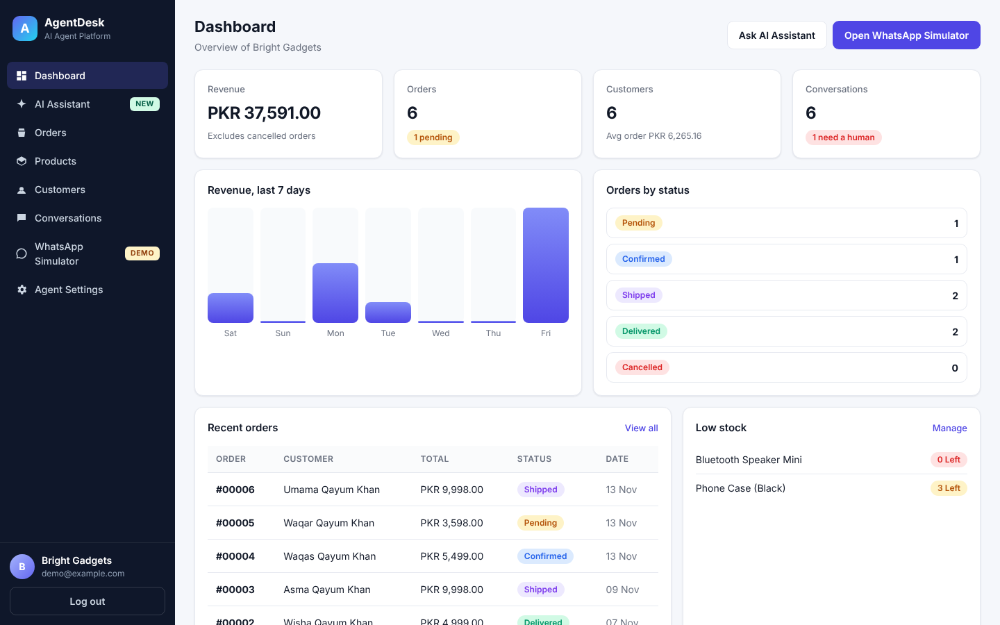

---

## Screenshots

| Customer orders on WhatsApp (demo simulator) | Owner manages the dashboard with the AI assistant |
|---|---|
| 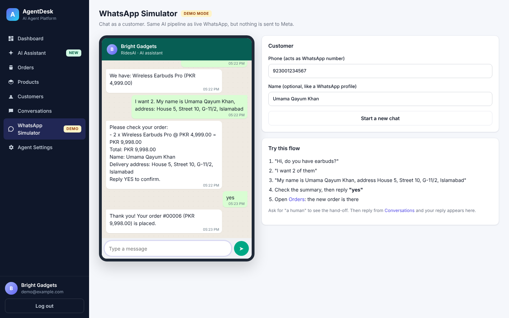 | 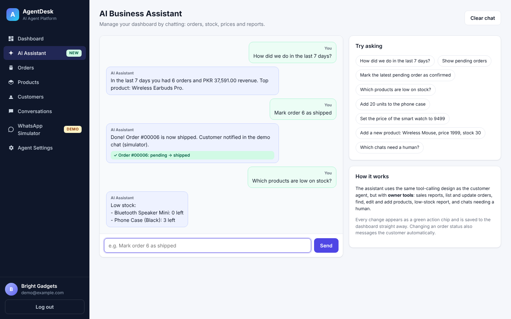 |
| **Customer gets an automatic order update** | **Orders** |
| 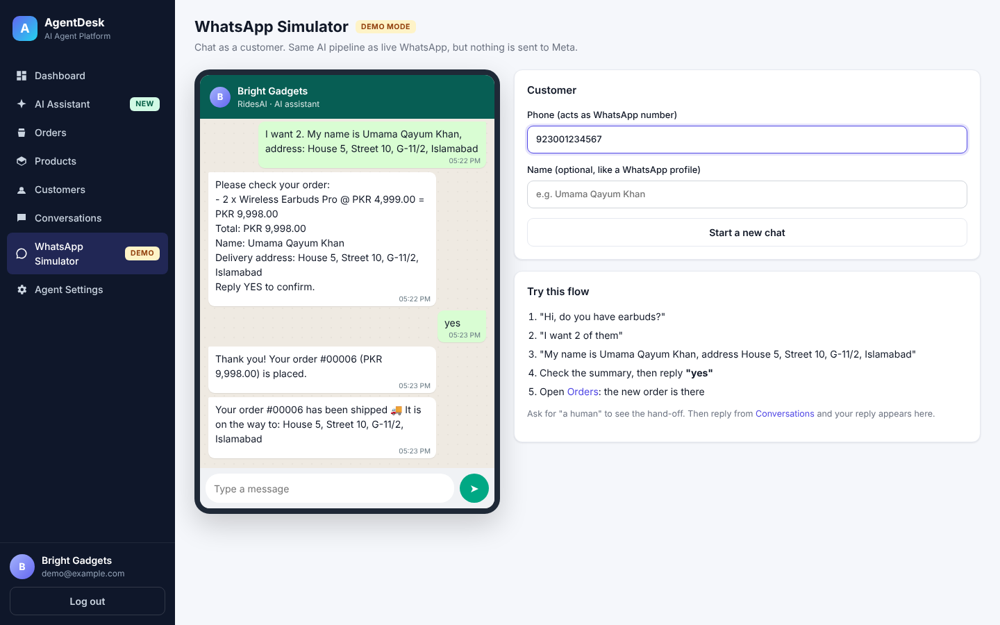 | 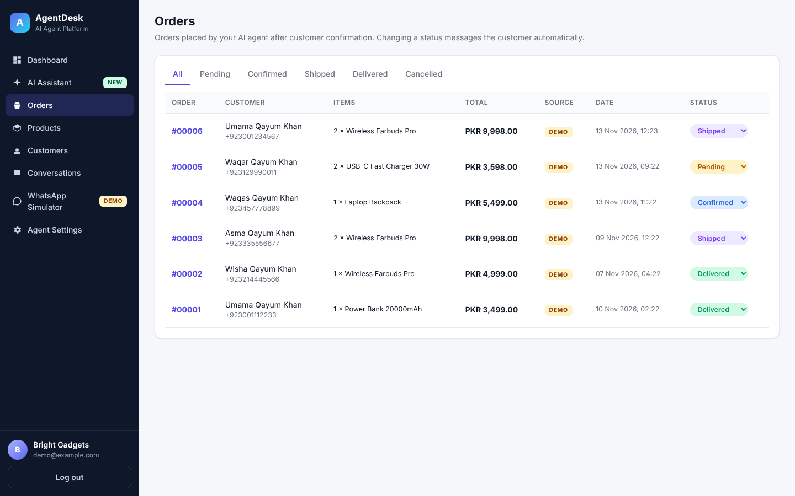 |
| **Order detail** | **Products** |
| 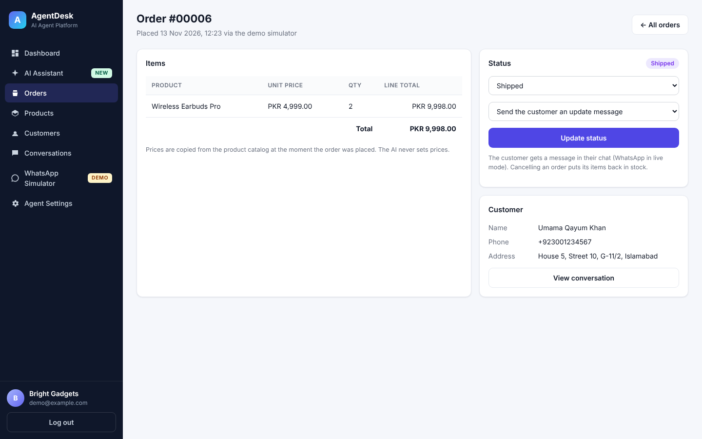 | 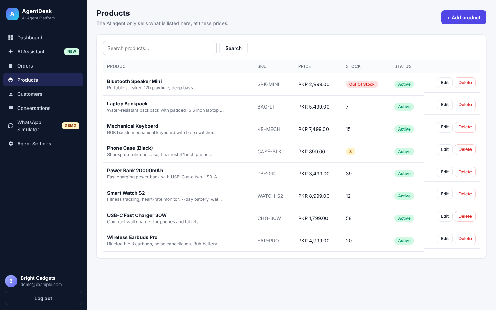 |
| **Conversations** | **Human hand-off** |
| 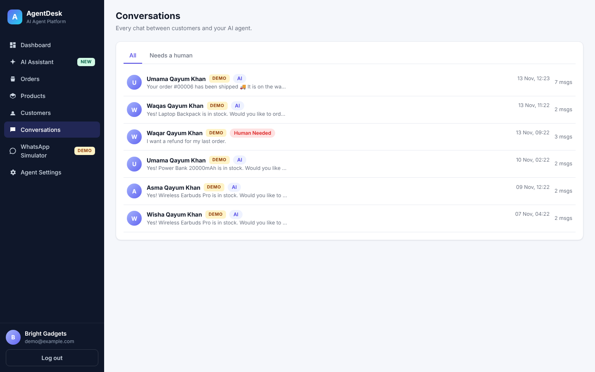 | 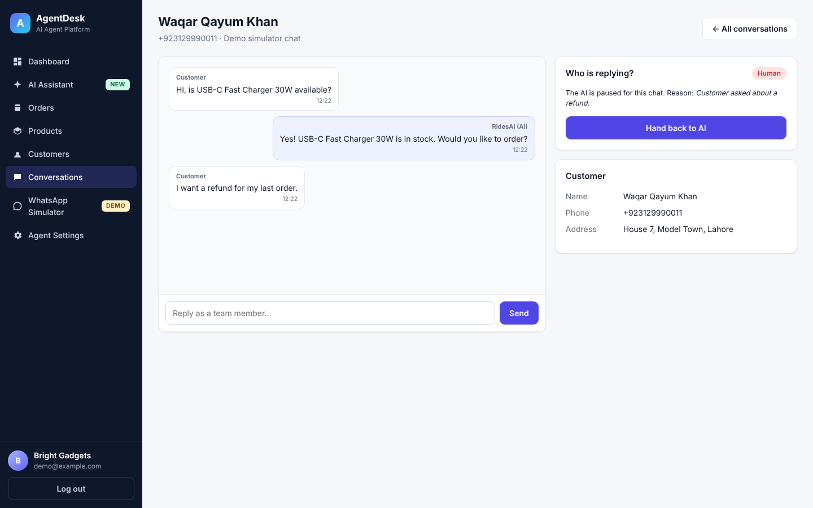 |
| **Agent and WhatsApp settings** | **Login** |
| 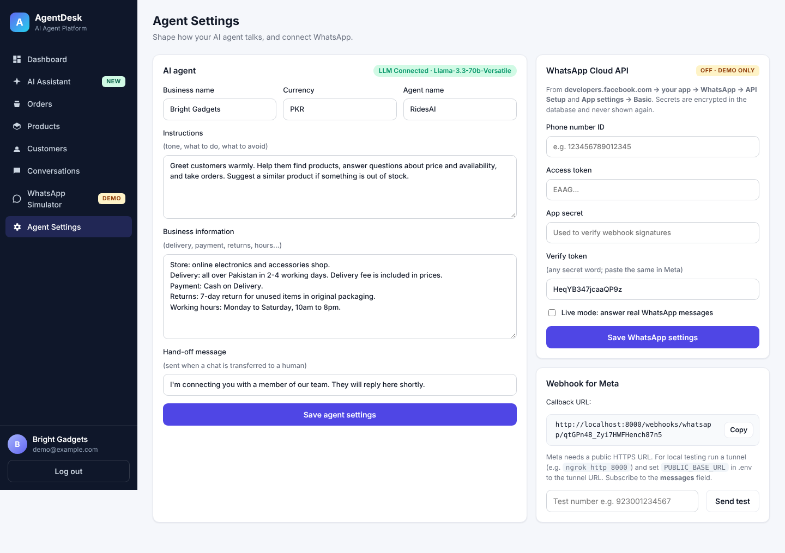 | 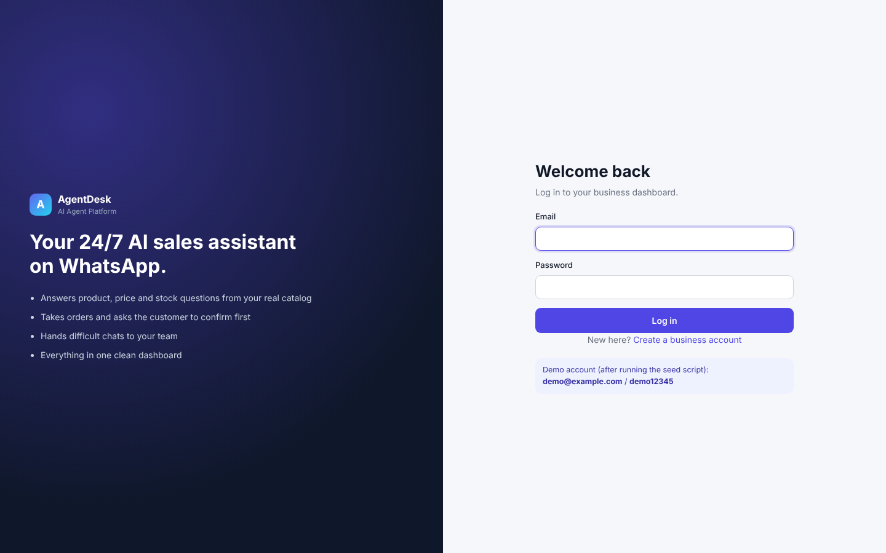 |

<p align="center">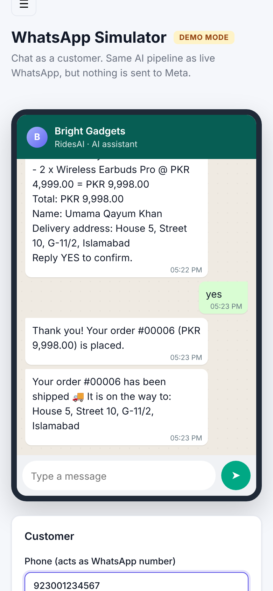<br><em>Responsive on mobile</em></p>

---

## 1. Features

| Area | What it does |
|---|---|
| **Business dashboard** | Register and log in, KPI cards (revenue, orders, customers, conversations), 7-day revenue chart, orders by status, low-stock alerts |
| **Products** | Add, edit, delete and hide products. Price, stock, SKU, description |
| **Orders** | Orders created by the AI, filtered by status. Change status (pending → confirmed → shipped → delivered / cancelled). Cancelling returns stock |
| **Automatic order updates** | Every status change (from the dashboard, the API or the AI assistant) sends the customer a message, on WhatsApp in live mode or in the demo chat |
| **AI Business Assistant** | The owner manages the dashboard by chat. Tools: `get_sales_report`, `list_orders`, `get_order_details`, `update_order_status`, `find_products`, `update_product`, `add_product`, `low_stock_report`, `conversations_needing_human`. Every change is shown as an action chip |
| **Customers** | Everyone who chatted, with order count and total spent |
| **Conversations** | Read every chat, reply as a human, take over from the AI or hand back |
| **Agent settings** | Agent name, instructions, business info (delivery, payment, returns), hand-off message, currency |
| **AI agent** | OpenAI tool calling: `search_products`, `get_product_details`, `prepare_order`, `confirm_order`, `cancel_pending_order`, `get_order_status`, `transfer_to_human` |
| **WhatsApp (live)** | Official Meta WhatsApp Cloud API: webhook verification, HMAC signature check, duplicate protection, AI replies sent through the Graph API |
| **WhatsApp Simulator (demo)** | A WhatsApp-style chat in the browser that uses the same AI pipeline, so the project can be demonstrated without Meta credentials |

**Demo vs live is always labelled.** The simulator, its conversations and its orders show a yellow **DEMO** tag. Real WhatsApp ones show a green **WhatsApp / LIVE** tag.

---

## 2. Run it on Windows 11 (VS Code)

You need **Python 3.11 or newer** (python.org; tick *"Add Python to PATH"* during install).

Open the project folder in VS Code, then open a terminal (**Terminal → New Terminal**) and run:

```powershell
# 1. Create and activate a virtual environment
python -m venv .venv
.venv\Scripts\activate
```

If PowerShell blocks activation, run this once and try again:
`Set-ExecutionPolicy -Scope CurrentUser RemoteSigned`

```powershell
# 2. Install packages
pip install -r requirements.txt

# 3. Create your settings file, then open .env and set OPENAI_API_KEY
copy .env.example .env

# 4. Create demo data (business, products, customers, orders)
python -m scripts.seed

# 5. Start the server
uvicorn app.main:app --reload
```

Open **http://localhost:8000** and log in with:

- **Email:** `demo@example.com`
- **Password:** `demo12345`

Or click **Create a business account** to start fresh.

After the first setup, you can just double-click `run.bat` to start the server.

### No OpenAI key? Use Groq (free tier)
The code uses the official `openai` Python library, which works with any OpenAI-compatible API. In `.env`:
```
OPENAI_API_KEY=gsk_your_groq_key
OPENAI_BASE_URL=https://api.groq.com/openai/v1
OPENAI_MODEL=llama-3.3-70b-versatile
```
Check the provider's current model list if a model name stops working.

### Try the full flow
1. Go to **WhatsApp Simulator**.
2. Send: `Hi, do you have earbuds?`
3. Send: `I want 2. My name is Umama Qayum Khan, address House 5, Street 10, G-11/2, Islamabad`
4. The agent shows an order summary with the total from the database. Reply `yes`.
5. Open **Orders**: the new order is there, and the product's stock went down by 2.
6. Send `I want to talk to a human` to see the hand-off, then reply from **Conversations**.
7. Open **AI Assistant** and type `Mark order 6 as shipped`. The order changes on the dashboard, and the customer automatically gets "Your order has been shipped 🚚" in the simulator chat.
8. Try `Which products are low on stock?` or `Add 20 units to the phone case`.

### Run the tests
```powershell
pytest
```
There are 37 tests. They use a fake LLM, so no API key or internet is needed.

API docs (Swagger) are at **http://localhost:8000/docs**.

---

## 3. Project structure

```
agentdesk/
├── app/
│   ├── main.py              # FastAPI app, middleware, error handlers, router registration
│   ├── config.py            # Settings from environment variables / .env
│   ├── database.py          # SQLAlchemy engine, session, Base
│   ├── models.py            # Database tables
│   ├── schemas.py           # Pydantic validation models
│   ├── security.py          # Password hashing, secret encryption, CSRF
│   ├── money.py             # Prices stored as integer cents
│   ├── deps.py              # Logged-in business dependency
│   ├── templating.py        # Jinja2 setup, filters, flash messages
│   ├── services/            # Business logic (no HTTP code here)
│   │   ├── agent.py         # LLM loop with tool calling (shared by both agents)
│   │   ├── tools.py         # Customer agent tools
│   │   ├── owner_assistant.py # Owner AI assistant (manages the dashboard)
│   │   ├── owner_tools.py   # Owner assistant tools
│   │   ├── notifications.py # Automatic order status messages to customers
│   │   ├── orders.py        # Pricing, stock, order creation, status changes
│   │   ├── conversation.py  # Shared message pipeline (simulator + WhatsApp)
│   │   ├── whatsapp.py      # Signature check, payload parsing, sending messages
│   │   ├── stats.py         # Dashboard numbers
│   │   └── accounts.py      # Business creation + sample data
│   ├── routers/             # HTTP endpoints
│   │   ├── auth.py          # /login /register /logout
│   │   ├── dashboard.py     # /dashboard /customers
│   │   ├── products.py      # /products (HTML forms)
│   │   ├── orders.py        # /orders
│   │   ├── conversations.py # /conversations (human replies, take over)
│   │   ├── settings.py      # /settings (agent + WhatsApp credentials)
│   │   ├── simulator.py     # /simulator + /api/simulator/*  (DEMO)
│   │   ├── assistant.py     # /assistant + /api/assistant/*  (owner AI assistant)
│   │   ├── api.py           # JSON REST API /api/*
│   │   └── webhook.py       # /webhooks/whatsapp/{key}       (LIVE)
│   ├── templates/           # Jinja2 HTML pages
│   └── static/              # CSS + JavaScript
├── scripts/seed.py          # Demo data
├── tests/                   # pytest suite
├── docs/INTERVIEW_GUIDE.md  # How to explain and demo this project
├── requirements.txt
├── .env.example
└── run.bat
```

---

## 4. How it works (simple explanation)

### 4.1 The message pipeline
Both the simulator and real WhatsApp call the **same function**, `handle_incoming_message()` in `services/conversation.py`:

1. **Find or create** the customer (by phone number) and their conversation.
2. **Save the message.** If it has a WhatsApp message id we have already seen, stop (duplicate).
3. If a **human** has taken over this chat, stop. The AI stays quiet.
4. Otherwise, run the **AI agent** and save its reply.

### 4.2 The AI agent (`services/agent.py`)
1. It builds a **system prompt** from the business's settings: agent name, instructions, business info, rules, the customer's known details, and any order waiting for confirmation.
2. It adds the last 20 messages of the chat as **history** (memory).
3. It calls the OpenAI Chat Completions API with the list of **tools**.
4. If the model asks to call a tool (for example `search_products("earbuds")`), our Python code runs it against the database and sends the result back to the model.
5. This repeats until the model writes a normal text reply, up to 6 rounds. If it hits the limit, the chat is handed to a human instead of looping forever.

### 4.3 Why tools? (the most important design choice)
The LLM **never decides facts**. It only decides *which tool to call*. Product names, prices, stock and order totals always come from the database:
- `prepare_order` receives only **product IDs and quantities**. Prices are read from the `products` table and totals are calculated in Python (`services/orders.py`).
- Money is stored as **integer cents** (`price_cents`), so there are no floating-point rounding errors.

### 4.4 Safe order confirmation (three guards)
`confirm_order` only places the order if:
1. a summary was prepared earlier (`pending_order` on the conversation),
2. the customer sent a **new message after** seeing the summary, so the model cannot confirm in the same turn, and
3. that message is clearly a **yes** ("yes", "confirm", "ok", "haan"...) and does not contain words like "no", "wait" or "change".

Prices are also re-checked at confirmation. If the business changed a price in between, the customer gets a fresh summary to confirm.

### 4.5 Human hand-off
The model calls `transfer_to_human` when a customer asks for a person, complains, or asks about refunds. Errors and missing configuration also hand off. The conversation status becomes `human`, the AI stops replying, and the dashboard shows **"Human needed"**. A team member replies from the dashboard and can hand the chat back to the AI.

### 4.6 Automatic order updates (`services/notifications.py`)
When an order status changes, `change_status_and_notify()` does four things in order: it updates the status (stock rules apply), adds a friendly message to the customer's chat, **commits**, and only then sends the message on WhatsApp. The customer is never told about a change that was not saved. The dashboard, the REST API and the owner assistant all use this one function. The business can choose "Don't notify" on the order page or use `?notify=false` in the API.

### 4.7 The AI Business Assistant (`services/owner_assistant.py`, `services/owner_tools.py`)
This is a second agent, for the business owner. It uses the **same tool-calling loop** (`run_tool_loop` in `agent.py`) but a different system prompt and a different set of tools. The owner types in plain language, and the agent chooses tools like `update_order_status` or `update_product`. Each tool:
- only touches the logged-in business's data (other businesses' IDs return "not found"),
- validates its input (no negative stock, valid prices),
- saves the change and records a short **action** ("Order #00006: pending → shipped") that the UI shows as a green chip, so the owner always sees exactly what the AI changed.

### 4.8 Security
| Concern | How it's handled |
|---|---|
| Passwords | PBKDF2-SHA256 with a random salt per user (`security.py`) |
| Sessions | Signed, HTTP-only session cookie. The session is renewed on login |
| CSRF | A token in the session is required on every form post and API write |
| Data isolation | Every table has `business_id`, and every query filters by the logged-in business. Other businesses' records return 404 |
| WhatsApp secrets | Access token and App Secret are encrypted (Fernet) before saving, masked in the UI, and never logged |
| Webhook authenticity | `X-Hub-Signature-256` HMAC-SHA256 check with the business's App Secret |
| Duplicate webhooks | `messages.external_id` (the WhatsApp message id) is UNIQUE. The message is saved and committed before the AI runs, so a retried delivery is ignored |
| Input validation | Pydantic schemas for forms and JSON |
| Headers | `X-Content-Type-Options`, `X-Frame-Options`, `Referrer-Policy` |

---

## 5. Connect real WhatsApp (live mode)

1. Go to **developers.facebook.com**, click **Create App**, choose type **Business**, and add the **WhatsApp** product.
2. Open **WhatsApp → API Setup** and copy:
   - the **Phone number ID**
   - an **Access token**. The temporary one lasts 24 hours. For a permanent token, create a System User in Business Settings.
   - Also add your own phone as a **test recipient** (the test number can only message added numbers).
3. Open **App settings → Basic** and copy the **App Secret**.
4. Expose your local server over HTTPS, for example:
   ```powershell
   ngrok http 8000
   ```
   Put the `https://...ngrok...` address in `.env` as `PUBLIC_BASE_URL`, then restart the server.
5. In AgentDesk, open **Agent Settings → WhatsApp Cloud API**. Paste the Phone number ID, Access token and App Secret, choose a **Verify token** (any secret word), tick **Live mode**, and save.
6. Copy the **Callback URL** shown in AgentDesk. In Meta, open **WhatsApp → Configuration → Webhook → Edit**, paste the Callback URL and the same Verify token, click **Verify and save**, then **subscribe to the `messages` field**.
7. Use **Send test** in AgentDesk, or message your WhatsApp test number from your phone. The AI replies on WhatsApp.

Live endpoints:
- `GET /webhooks/whatsapp/{webhook_key}`: Meta verification (`hub.mode`, `hub.verify_token`, `hub.challenge`)
- `POST /webhooks/whatsapp/{webhook_key}`: incoming messages. The server checks the signature, returns `200` immediately, and processes the message in a background task.

Each business has its own random `webhook_key`, so one server can serve many businesses, each with its own Meta app and number.

Notes:
- Businesses can only send free-form replies within 24 hours of the customer's last message. Messages outside that window need approved templates; that is out of scope for this MVP.
- Non-text messages (images, voice notes) get a polite "please type your message" reply.

---

## 6. REST API (session-authenticated)

| Method | Path | Purpose |
|---|---|---|
| GET | `/api/me` | Current business |
| GET | `/api/stats` | Dashboard numbers |
| GET / POST | `/api/products` | List / create products |
| PUT | `/api/products/{id}` | Update a product |
| GET | `/api/orders?status=` | List orders |
| GET | `/api/orders/{id}` | Order detail |
| PATCH | `/api/orders/{id}/status?notify=true` | Change status (and message the customer) |
| POST | `/api/assistant/message` | Owner AI assistant: send a command |
| GET | `/api/assistant/messages` | Owner AI assistant: chat history |
| POST | `/api/simulator/message` | Demo: send a customer message |
| GET | `/api/simulator/messages?phone=` | Demo: chat history |
| POST | `/api/simulator/reset` | Demo: start a new chat |
| GET | `/health` | Health check |

Write requests need the `X-CSRF-Token` header (the value is in the page's `<meta name="csrf-token">`).

---

## 7. Moving to production (next steps)

- **PostgreSQL:** set `DATABASE_URL=postgresql+psycopg://...` and `pip install psycopg[binary]`. No code changes are needed.
- **Alembic** migrations instead of `create_all`.
- A **job queue** (Celery/RQ/Arq) for webhook processing instead of FastAPI background tasks, with retries.
- **Rate limiting** on login and webhooks, plus account lockout.
- WhatsApp **message templates** for messages outside the 24-hour window, and delivery/read status tracking.
- Real **RAG** over business documents (FAQ, policies) with embeddings, in addition to the product database.
- Docker image, HTTPS, `ENVIRONMENT=production` (enables secure cookies and requires a strong `SECRET_KEY`).

---

## 8. Upload to GitHub

1. Create a new **empty** repository on github.com (no README), for example `agentdesk`.
2. In the project folder, run:
   ```powershell
   git init
   git add .
   git commit -m "AgentDesk: AI agent platform for WhatsApp businesses"
   git branch -M main
   git remote add origin https://github.com/YOUR-USERNAME/agentdesk.git
   git push -u origin main
   ```
3. Before pushing, run `git status`. You should **not** see `.env`, `agentdesk.db` or `.venv`, because `.gitignore` excludes them. Never upload your API key.
